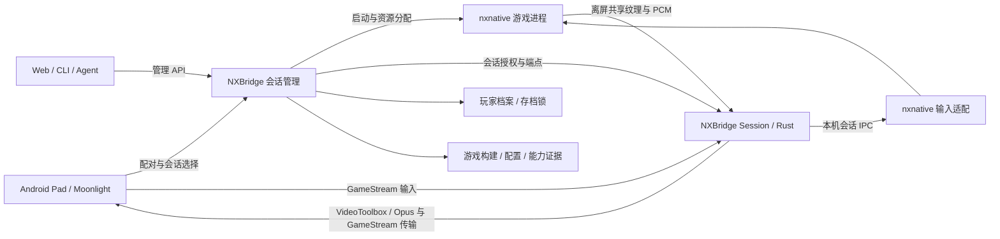

# 系统架构

状态：目标架构，见 [ADR-0002](decisions/0002-rust-offscreen-server.md)。Rust Host / Session 与离屏媒体尚未实现；USB 输入原型已完成，不能替代 LAN / 多会话验证。

每条媒体与输入连接都归属于一个 session_id 和运行 / 控制代次。Host 采用 Rust；每个游戏配一个 NXBridge 媒体进程，统一部署并保留故障隔离。目标链路不需要外部 Sunshine 或桌面采集。

输入路径预留可选的会话内动作执行器：在认证触发之后、运行时输入采样之前生成有限序列，合成人工 / 宏状态并支持取消。它不进入媒体 ABI，也不增加独立 LAN 输入服务；客户端触发绑定、采样与归属要求见 [输入桥迭代需求](input-bridge-requirements.md)，均待实现。

## 组件边界

| 组件 | 职责 | 起点与状态 |
| --- | --- | --- |
| Host / Session Manager | 玩家、配对、实例生命周期、容量、端点分配、恢复 | Rust 自研，待实现 |
| Management API / Web | Web、CLI 与 agent 共用管理逻辑；游戏库、设备、会话与诊断 | 产品化设计，见 [Web 与多游戏设计](web-management-and-game-library.md)，待实现 |
| Runtime Adapter | 以明确路径启动 nxnative，绑定 PID / 启动时间 / 运行代次，接入帧、PCM 和输入 | 现有输入原型可复用，离屏接入待实现 |
| Media Worker | 独立源、VideoToolbox / Opus 编码、GameStream 传输、统计 | Rust；Moonshine 协议复用候选，Mac 后端待实现 |
| Input Bridge | 认证会话路由、按键 / 摇杆、释放和体感 | USB 单路原型已验证；LAN 代次与隔离待实现 |
| Android Client | 硬件解码、显示、触屏 / 手柄、会话选择 | 先用 Moonlight 原版验证；必要时扩展 |
| Evidence Tools | 记录运行环境、指标、失败与恢复 | 工程检查、环境预检、输入行为测试及探索性实验记录 |

## 复用方案与缺口

NX2Apple 是构建 / 启动封装，nxnative 是游戏引擎；NXBridge 复用引擎与构建工具，不重新实现游戏重编译和图形兼容层。Rust 协议与管理层通过平台绑定或少量 C / Objective-C 调用 Apple API。

Moonshine 提供 Rust GameStream 服务端参考，但所查修订仅支持 Linux，依赖 systemd、合成器、音频与 Vulkan 编码。先审计可复用协议和平台耦合，再在 Mac 上实现测试帧 / PCM 到 Moonlight 的闭环；不是直接引入一个已验证的 Mac SDK。

协议范围包括发现 / 配对 / 证书、游戏列表与启动恢复、RTSP 协商、音视频分包 / 纠错 / 加密、输入 / 心跳与重连。Moonlight 继续负责客户端硬解码与输入；原版客户端的多会话身份、端点和“当前游戏”状态兼容必须验证。

目标由 Host 管理配对身份并给各 worker 分配授权、端点和状态。若单一主机身份无法满足客户端的独立会话行为，再依据实验固定虚拟主机端点方案，不能预设同端口即可多开。

Sunshine 保留为音视频质量、协议行为和性能对照；必要时作为过渡后端。过渡多 worker 仍需独立完整端口组、配对材料与源，不把其多客户端称为独立多实例。当前 USB 输入原型可用于运行时接入验证，正式 LAN 输入经认证的 Rust 会话通道转交，不依赖 macOS 虚拟手柄 Broker。

## 视频和音频

- 起步为 SDR、H.264、720p。编码优先 macOS VideoToolbox；客户端确认实际使用联发科硬解码器。
- 原生视频来自 nxnative 最终渲染纹理，必要时在 GPU 上转换到 IOSurface / CVPixelBuffer 后编码；按游戏进程与运行代次绑定，无需桌面或游戏窗口采集。
- 原生音频为运行时 PCM 输出，每会话独立时钟和有界缓冲。替代 AudioUnit 消费节奏、保持游戏呈现与 fence 语义是离屏实现的必要工作。
- GPU 写完才能交给编码器，编码器释放后才能复用帧；共享句柄和同步需原型验证，不预先承诺全链路零拷贝。
- ScreenCaptureKit 窗口采集和按进程音频采集只作为可选过渡；仍须验证遮挡 / 最小化和同应用多进程声音隔离。
- 原生源或过渡窗口失效时停止或显示等待画面；不能退回完整桌面或其他玩家的源。
- 采集、编码、发送队列有上限，发生拥塞时报告丢帧，避免不断积压提高延迟。

## 实现边界

首个原生版本在已登录用户会话中运行，不创建可见游戏窗口。无物理显示器、锁屏和未登录是独立能力；无窗口测试不能证明无需 WindowServer。GPU 仍完整渲染每路游戏。

Host / 协议采用 Rust，Mac 桥接沿用平台 C / Objective-C API。产品化采用内置 Web 管理入口与统一管理 API，前端框架在原型后确定；Moonlight 继续承担音画和实时输入。游戏差异通过有版本的构建与配置表达，通用服务不绑定 BOTW。Rust 语言选择不构成内存或延迟收益证据，所有收益与 Sunshine 基线对照测量。

每个游戏构建都记录 nxnative / NX2Apple 修订号、工具链、游戏版本和图形设置。不要混用最新 main、旧 shader 产物和未经验证的补丁后仍声称结果可复现。

接口、实施阶段和证据见 [服务端设计](game-session-server.md)，来源修订见 [上游快照](../config/upstreams.json)；容量与故障隔离细节见 [会话设计](sessions.md)。
