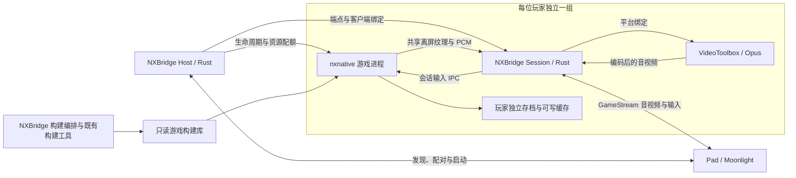

# NXBridge 游戏会话服务端设计：Rust 原生串流与离屏输出

日期：2026-11-02，修订 2。状态：目标架构；Rust 服务端与离屏输出尚未实现。决策见 [ADR-0002](decisions/0002-rust-offscreen-server.md)。现有实验事实、建议方案和待验证能力分别注明。

目标：NXBridge 以 Rust 实现 Moonlight 兼容的 GameStream 服务端，直接管理 nxnative 游戏进程；游戏在 Metal 纹理中离屏渲染，输出音画到 Pad。正式运行链路无需 NX2Apple 启动器或独立的 Sunshine 服务，也不要求 Mac 桌面显示游戏窗口。

本文补充 [系统架构](architecture.md) 与 [多玩家与实例隔离](sessions.md)，集中说明服务端封装、媒体输出和内存优化。任务状态仍以 [backlog](../tasks/backlog.json) 为准。已完成的 [USB 单会话输入原型](reports/NXB-045.md) 为运行时输入接入提供证据，不代表原生 LAN 服务已完成。

后续产品入口采用内置 Web 管理界面，Web、CLI 和 agent 共用 Host 管理 API；BOTW 作为首个验证游戏，其他构建按游戏配置和能力记录扩展。管理层与媒体处理的边界、游戏库及分阶段交付见 [Web 管理与多游戏支持设计](web-management-and-game-library.md)。

## 1. 设计结论与边界

- NX2Apple 是构建与启动封装，nxnative 提供游戏运行引擎。NXBridge 接管构建编排和启动，复用引擎及既有构建工具；不重写游戏重编译、系统接口兼容和 NVN→Metal 实现。
- Rust 负责会话管理与 GameStream 兼容协议；Metal、IOSurface、VideoToolbox 通过平台绑定或少量 C / Objective-C 适配调用。目标不是把所有平台库重写为 Rust。
- 一个共享的会话管理器，管理多组独立的游戏进程和 NXBridge 媒体 worker。产品统一部署，进程仍保留故障隔离。
- Sunshine 保留为单路性能基线、协议行为对照和必要的过渡后端。指定窗口采集是可选过渡实验，不是 Rust 协议原型或离屏输出的前置依赖。
- 首个原生版本以“已登录用户会话内，无可见游戏窗口，直接输出音画”为目标。无物理显示器、锁屏和开机未登录能力分别验收。
- 原生 macOS 多进程是部署基础，Lima、Docker、完整 macOS 虚拟机不进入首版运行链路。
- 内存优化首先控制媒体缓冲和启动峰值，再依据测量调整游戏缓存。取消桌面采集不等于消除游戏自身数 GiB 的工作集。
- 家庭目标为 2–3 位玩家；M4 / 16 GB 的并发容量未知。`measured_session_capacity` 保持 `null`，直到各路分别通过验收。

### 产品愿景与阶段边界

长期愿景是把 Mac 做成家庭共享的原生游戏主机，让每块 Pad 成为独立玩家的游戏入口。玩家选择自己的档案即可进入已适配游戏，保持独立进度，换设备后可以接回同一主机上保留的会话；主机负责构建版本、资源接纳、排队和恢复。

产品价值以真实游玩的帧时间、输入到画面延迟、启动 / 重连体验和每台主机承载人数衡量。Rust 服务端、直接音画输出和统一部署是实现手段，语言更换或组件数量减少本身不构成优势。

首版先完成一台 Mac 上的原生单路闭环，再验证多玩家。容量不足时预留将新会话分配给另一台 Mac 的边界。多主机统一调度、运行中跨机迁移、跨游戏通用兼容和引擎重写均不作为本轮交付条件；设备接回会话也不等于迁移游戏进程。

## 2. 现有依据

| 项目 | 已观察或已核对的事实 | 结论边界 |
| --- | --- | --- |
| 本地游戏 | BOTW 已进入户外；有约 30 FPS 的探索性样本 | 场景、路线与重复次数不足以完成正式性能验收 |
| 串流 | Sunshine 与 Moonlight 已短时显示桌面中的游戏；一次实际协商为 720p60 HEVC / VideoToolbox | 没有验证窗口级串流、多实例隔离或端到端输入延迟 |
| 音频 | 授权后主机音频采集、Opus 和客户端 AudioTrack 初始化成功 | 平板声音尚未听验，进程级音频隔离尚未验证 |
| 输入 | NXB-045 已验证 USB ADB 通道中的按键、双摇杆、组合触摸和断线清零到达单个游戏进程 | 仍需迁移至认证的 LAN 会话通道，补齐代次、重连与多玩家隔离 |
| Sunshine 视频后端 | 所查修订通过 `AVCaptureScreenInput` 选择显示器，已有 NV12 / CVPixelBuffer 编码缓冲直传路径 | 窗口采集和运行时帧输入需要适配；不能预设已有大量 CPU 图像复制可供消除 |
| nxnative 窗口生命周期 | `front_mac.m` 的最小化回调调用 `dm_audio_suspend(1)` 和 `dm_gfx_suspend(1)` | 隐藏或最小化窗口不能直接当作后台服务方案 |
| nxnative 呈现与音频 | 当前呈现涉及 `CAMetalLayer` / `CAMetalDisplayLink`；音频消费由 AudioUnit 回调驱动 | 离屏输出必须保持游戏同步语义，并提供持续的音频消费节奏 |
| Rust 协议候选 | Moonshine 已提供面向 Moonlight 的 Rust 服务端，所查修订声明 Linux only | 依赖 Linux 合成器、音频和 Vulkan 编码链路；不是可直接在 Mac 使用的协议 SDK |

本地实验环境为 Apple M4 / 16 GB、macOS 26.5、Xcode 26.5。实验使用的 Metal 编译器与引擎锁定版本不同，视觉正确性与兼容性仍待验证。详见 [构建实验记录](reports/NXB-010.md) 和 [串流准备记录](reports/NXB-030-preparation.md)。

本次讨论使用的修订依据：

- NX2Apple 实验源码：`41f7d6ba920927856316f6e04af1c50e437eb9c3`。
- 本地实验引擎提交：`b8d16169c5fb7a3c6a936a950e294b1df4680551`；工作树可能包含实验补丁，提交号不能代替补丁记录。
- Sunshine 源码参考：`63d35f702ee9e362e43263742981836ec0710384`，对应参考版本 `v2026.914.233613`。
- Moonshine 调研修订：`79554f853135cbac44502b58093a4eb0f0f5e6f1`，Cargo 版本 `0.16.1`；仅阅读源码，未在 Mac 构建或验证。

以上并非经过验收的兼容构建锁；[上游调研快照](../config/upstreams.json) 与实际实验版本也需区别对待。

## 3. 服务与进程组织



| 组件 | 职责 | 封装方式 |
| --- | --- | --- |
| 会话管理器 | 玩家档案、配对身份、存档写者锁、排队、启动退出、重连、资源统计 | Rust 控制服务；不进入每帧处理路径 |
| Runtime Adapter | 启动既定构建，设置独立路径，登记 PID / 启动时间 / 运行代次，接入帧与 PCM | 沿用 nxnative，引入薄适配层；窗口身份仅用于过渡采集 |
| 游戏进程 | 游戏状态、渲染、音频生成、输入消费 | 每个独立玩家一个进程，保留故障边界 |
| 媒体 worker | 帧与 PCM 接入、硬件编码、GameStream 数据传输、输入转发 | 每会话一个 NXBridge Rust 进程；Sunshine 为过渡 / 对照后端 |
| 客户端 | 解码显示、输入、会话连接 | 优先验证原版 Moonlight；必要扩展单独列出 |

协议并不绑定实现语言。需实现的是 Moonlight 使用的 GameStream 行为及选定扩展，而不是“NX2Apple 网络协议”或“Sunshine Rust 协议”。Moonshine 的可复用范围先通过依赖审计和 macOS 原型确定；不能将 `cargo add` 成功视为可用的 Mac 服务端。若借用上游代码，固定修订并保留相应许可与来源记录。

| 协议范围 | 原型必须验证的行为 |
| --- | --- |
| 控制面 | 发现 / 手动添加、配对和证书验证、主机能力、游戏列表、启动、恢复与停止 |
| 会话协商 | RTSP 及编解码能力协商，分辨率、帧率、音频格式和实际协商结果一致 |
| 媒体与控制数据 | 音视频分包、序号、纠错、所选加密模式、关键帧请求、输入 / 心跳与有界发送队列 |
| 生命周期 | 断线中和、重连代次、旧包拒绝、取消和端口 / 缓冲回收 |

目标由 Host 管理持久配对身份，并向 worker 分配会话授权、端点与独立状态。单个主机身份的多会话协商、客户端对“当前游戏”的假设和非默认端点兼容均待验证；不能预设原版 Moonlight 自动支持任意路由。若需要分配独立虚拟主机身份，先记录协议实验结果，再固定端点方案。过渡 Sunshine worker 仍需独立完整端口组与配对配置。

部署起点是在已登录用户的图形会话中运行服务，可评估 LaunchAgent。安装与首次系统授权由管理员完成。开机未登录、锁屏、显示器断开后的运行能力分别验收；“不共享桌面内容”不代表“不依赖图形会话”。

## 4. 实施阶段与可选过渡路径

| 阶段 | 交付 | 进入下一阶段的条件 |
| --- | --- | --- |
| 基线 | 现有 Sunshine / Moonlight、USB 输入原型与本机游戏样本 | 固定版本、补齐音频和可复现测量；保留对照数据 |
| Rust 协议原型 | Mac 产生离屏测试帧与 PCM，NXBridge 直接服务 Moonlight | 配对、真实硬件编解码、输入事件接收和重连通过；无需游戏或 Sunshine |
| 运行时输出原型 | nxnative 导出共享帧和 PCM，采用独立呈现 / 音频时钟 | 无可见游戏窗口时保持游戏速度、帧节奏与缓冲释放正确 |
| 单路原生接入 | Rust 媒体链路接入真实游戏和认证 LAN 输入 | 声音、操控、延迟和稳定性通过，与 Sunshine 同条件对照 |
| 多会话与容量 | 生命周期、存档锁、端点路由，逐步增加到 2 / 3 路 | 各路分别达标；并发数量以实测登记 |

Rust 协议原型和运行时输出原型是可独立推进的工作边界，不表示自动启用多个 agent。窗口采集只在需要过渡体验或定位问题时实施，不要求先完整开发一套 Sunshine 多实例服务。

### 可选窗口采集：视频

需要窗口过渡时，可为 Sunshine 增加 ScreenCaptureKit 画面源，使用指定窗口过滤器绑定本次游戏的 PID、启动时间和窗口身份。Apple 提供只捕获指定窗口的 [`SCContentFilter.init(desktopIndependentWindow:)`](https://developer.apple.com/documentation/screencapturekit/sccontentfilter/init%28desktopindependentwindow%3A%29)。

采集尺寸按串流目标设置，起步为 720p SDR；码率、编码格式与帧率遵循 [验证规程](validation.md)，实际协商结果单独记录。30 FPS 游戏分别对照 30 / 60 FPS 视频流，评估延迟、编码负载和画质，不能将接收 60 FPS 当作游戏 60 FPS。

窗口关闭、身份变化或源不可用时停止该源或输出等待画面，禁止退回完整桌面或另一玩家的窗口。需测试通知、其他应用覆盖和不同玩家窗口同时存在时的画面归属。

### 可选窗口采集：音频与输入

音频候选为按游戏进程采集，或提前接入运行时 PCM。具体按进程采集可评估 [Core Audio taps](https://developer.apple.com/documentation/coreaudio/capturing-system-audio-with-core-audio-taps)，同一应用的多个进程能否严格分开仍须实测。窗口过滤器本身不能作为音频隔离证据。

输入沿用 [输入桥设计](input-bridge.md)，只路由到绑定实例；不使用全局键鼠事件或当前窗口焦点。当前触屏原型与正式媒体 worker 输入通道的衔接，须依据后续验证结果完成。

### 过渡路径的完成条件

- Pad 只出现目标游戏内容，其他桌面内容不进入视频流。
- 两个实例使用可辨认的画面、音频和输入标记，证实没有串线。
- 失焦、遮挡、最小化分别记录游戏帧率、音频和采集状态；如需改动 nxnative 生命周期，单独回归游戏速度与同步行为。
- 窗口和进程退出后及时解除绑定，重连不会恢复到复用的 PID 或旧窗口。

过渡路径可以交付应用级串流。它不证明原生离屏链路已完成；减少多少内存、是否能保持后台渲染，均以测量为准。

## 5. 目标路径：运行时直接输出音视频

### 视频路径与缓冲生命周期

```text
游戏最终 Metal 纹理
  → 必要的 GPU 缩放 / 色彩与 NV12 转换
  → IOSurface 支撑的 CVPixelBuffer
  → VideoToolbox 硬件编码
  → NXBridge Rust GameStream 媒体传输
  → Moonlight 硬件解码与显示
```

[IOSurface](https://developer.apple.com/documentation/iosurface) 提供跨进程图像缓冲共享能力；Sunshine 已有将 CVPixelBuffer 交给 VideoToolbox 的 [NV12 路径](https://github.com/LizardByte/Sunshine/blob/63d35f702ee9e362e43263742981836ec0710384/src/platform/macos/nv12_zero_device.cpp)。设计目标是避免 CPU 回读和多余复制，具体共享方式、像素格式和同步组合仍需原型验证。

在最终窗口呈现之前接入帧输出，保留必要的裁剪、色彩空间和尺寸信息。普通 Metal 纹理并不自动成为可跨进程编码的缓冲；必要时通过 GPU 转换或复制到可共享缓冲池。截图回调、CGImage / PNG 和逐帧 CPU 图像中转不进入正式视频路径。

帧池与发送队列均有容量上限，容量依据编码器持有时间和测量结果确定。仅在 GPU 写入完成后允许编码器消费，且在编码器释放后才能复用缓冲；跨进程传递有效共享句柄与完成信号，不传裸指针。拥塞时优先丢弃尚未提交编码的旧帧，已被 GPU 或编码器占用的资源仍须等待安全释放。

### 接口契约草案

下表概述职责；合成源与游戏源共用的版本化描述符、时钟、缓冲与释放语义已在 [媒体接口 v1](media-abi-v1.md) 固定。平台句柄传输和实际离屏实现仍待验证。

| 边界 | 必须携带或保证的内容 |
| --- | --- |
| 视频帧源 | session_id、运行代次、frame_id、主机单调时钟时间戳、尺寸 / 像素格式 / 色彩信息、缓冲句柄、完成与释放协议 |
| 音频源 | 会话归属、采样率 / 声道 / 格式、样本序号与时间戳、有界 PCM 缓冲、欠载 / 丢弃计数 |
| 输入接收端 | 会话和控制权代次、顺序与新鲜度检查、按键 / 摇杆状态、明确释放与断线中和 |
| 生命周期 | 创建、就绪、停止、错误及资源回收；旧会话数据不得进入新会话 |

### 呈现和音频时钟

当前 `dm/gfx/nvn/nvn_mtl.m` 的呈现与 CAMetalLayer / CAMetalDisplayLink 相关。离屏模式需要独立的调度与呈现完成机制，同时保持游戏的排队、fence 和帧节奏语义。删除窗口或跳过 present 不足以证明游戏仍正确运行。

从 `dm/host/hle_audio.c` 的游戏音频消费 / 混音边界导出 PCM，再交给 worker 编码。若移除物理音频输出，必须替代原 AudioUnit 回调的消费节奏，处理时钟漂移与音画同步；静音或失去声卡回调不能导致游戏音频队列停止推进。

先验证单实例的无窗口输出，再扩展到多实例。GPU 仍然为每位玩家完整渲染游戏，画面存在于纹理与帧缓冲中；取消本地显示不会消除游戏的主要 GPU 工作量。

| 主机状态 | 本方案的定位 | 当前验证状态 |
| --- | --- | --- |
| 已登录，不创建可见游戏窗口 | 首个原生版本必须达到；帧直接送编码器，不采集桌面 | 待实现 / 待验证 |
| 不接物理显示器 | 目标支持；测试冷启动与热拔插，记录是否依赖虚拟显示设备 | 未验证 |
| 锁屏后继续运行 | 独立生命周期能力，不由无窗口结果推导 | 未验证 |
| 开机未登录或用户退出登录 | 后续部署研究，不属于首个原生版本承诺 | 未验证 |

无窗口验收必须确认没有通过隐藏窗口、虚拟桌面或屏幕采集继续提供游戏帧。无显示器测试不代表没有 WindowServer 依赖；未登录运行也不能仅凭 LaunchAgent 配置宣称成功。只有原生链路通过对应条件测试，才登记该能力。

## 6. 内存预算与优化顺序

### 当前游戏占用的量级

从 2026-11-02 的两份本地实验日志提取 `footprint N MiB`，取各日志已记录样本的最大值：

| 日志 | 记录数 | 已记录样本最大值 |
| --- | ---: | ---: |
| `initial-game.log` | 191 | 4,431 MiB，约 4.33 GiB |
| `stream-game.log` | 23 | 3,877 MiB，约 3.79 GiB |

日志位于忽略目录 `.nxbridge/experiment-010/`；这是游戏进程日志中的 footprint 口径，不是整台主机总量，也不是连续监测得到的严格峰值。两次场景、运行时长和缓存状态不同，不能据此推断串流降低了内存。统一内存下 GPU 分配统计与进程 footprint 可能重叠，不直接相加。

原始日志摘要校验值，便于同事确认使用的是同一批证据：

```text
initial-game.log SHA-256
ef04a0bb1dbabc7208d1aed2cf8a55c18770a117cb48a629487a7ba1c8d629f0
stream-game.log SHA-256
e215770f8de5b1f91426b2fa30b1975a0f78f9ce3237fb2555d29fa909e7dca5
```

### 媒体缓冲的理论量级

以下按 BGRA8 每像素 4 字节、8 位 NV12 每像素 1.5 字节计算，不包含行对齐、编码器内部参考帧、采集器和其他分配：

| 分辨率 | BGRA8 每帧 | NV12 每帧 |
| --- | ---: | ---: |
| 1280 × 720 | 3.52 MiB | 1.32 MiB |
| 1920 × 1080 | 7.91 MiB | 2.97 MiB |
| 3840 × 2160 | 31.64 MiB | 11.87 MiB |

例如，同为三个 BGRA 缓冲，720p 约 10.55 MiB，4K 约 94.92 MiB。这仅说明分辨率和队列深度的量级，不代表当前采集就是 4K，也不代表实际改造必然节省这些内存。

### 优化优先级

1. **控制媒体附加开销。** 按目标尺寸分配，限制在途帧和排队；复用现有硬件编码路径，测量新增适配是否反而引入重复缓冲。
2. **控制启动峰值。** NX2Apple 构建工具不随每个会话常驻；错开多实例加载和管线预热。分别记录冷启动、暖启动和稳定运行占用。
3. **共享不可变资源。** 游戏构建与只读缓存种子共用文件，适合时利用映射和系统页缓存。各实例可写缓存仍隔离；共享文件不等于 Metal 纹理或管线对象已经跨进程共享。
4. **分析游戏缓存预算。** 对纹理、管线、延迟释放队列做分类测量，区分活跃、在途和可淘汰对象。“未引用”计数不自动等于泄漏或可立即释放；缓存裁减须验证重新编译、重传和帧时间代价。
5. **释放空闲会话。** 断线宽限后按可靠的保存 / 正常退出流程释放资源。暂停进程通常仍占用内存；不能将暂停视为回收，也不能伪造保存成功。

不预先承诺固定节省比例。M4 / 16 GB 是否可双开或三开，同时取决于游戏工作集、GPU 执行时间、编码资源、系统开销和交换压力，须通过并发测试确定。

Rust 重写本身不构成内存或性能收益证据。对比时分别记录 Host、媒体 worker、游戏进程和系统总压力；保留故障隔离，不为减少进程数量将全部游戏合入一个地址空间。

## 7. 验证与后续实施顺序

性能门槛沿用 [性能与验收](validation.md)。比较时固定构建、补丁、存档路线、图形设置、编码参数和采样区间；游戏 FPS、媒体 FPS、输入到画面延迟分别报告。

| 验证步骤 | 比较对象或故障条件 | 需要产出的证据 |
| --- | --- | --- |
| Rust 协议原型 | Mac 离屏测试帧与 PCM，原版 Moonlight，Sunshine 不参与 | 配对、协商、实际硬解 / 硬编、输入事件、加密 / 纠错和断线恢复 |
| 窗口源原型（可选） | 同一场景下完整桌面与指定窗口采集 | 画面边界、采集 / 编码耗时、进程 footprint、缓冲数量、游戏帧时间 |
| 双会话隔离 | 不同玩家画面 / 音频 / 输入标记，独立 worker 端点 | 无串线，存档无覆盖，配对 / 发现 / 连接可复现 |
| 生命周期 | 失焦、遮挡、最小化、锁屏、断开显示器 | 各条件下帧率、音频推进、可控性与明确支持范围 |
| 直接输出原型 | Sunshine 基线与 Rust 运行时帧 / PCM 输出，窗口过渡仅在已实现时加入 | 无窗口来源证据、复制与缓冲开销、音画同步、游戏速度、资源释放正确性 |
| 承载容量 | 按 1 → 2 → 3 路逐步增加 | 每路独立帧时间和延迟；系统内存压力、swap、启动峰值、编码与 GPU 负载 |
| 故障恢复 | 客户端断线、worker 崩溃、游戏退出、旧会话重连 | 输入中和，无旧帧 / 旧音频串入，目标资源回收，其他会话继续运行 |

实施顺序建议：

1. 保留 NXB-045 的已完成原型，继续 NXB-010 / NXB-020 / NXB-030 的环境与正式基线。
2. NXB-032 审计 Moonshine 的可复用协议与平台依赖，在 Mac 验证 Rust 合成音画服务端；NXB-035 单独验证 nxnative 离屏帧 / PCM 输出。
3. NXB-037 将两条原型接成单路真实游戏链路，接入认证 LAN 输入，并与 Sunshine 同条件比较。
4. NXB-040 / NXB-050 / NXB-060 完成双实例隔离、正式输入路由和生命周期；NXB-065 记录显示器与登录状态的支持矩阵。
5. 按 NXB-070 执行承载测试，达到所有会话的门槛后更新可接纳容量；以此决定原生后端的正式切换，保留可复现的对照配置。

本文件交付的是设计和验收边界；没有新增服务端实现，也没有执行新的设备、串流或性能实验。

## 8. 参考资料

查阅日期：2026-11-02。上游引用采用本次已核对的修订；实际开发仍须记录新的基线和差异。

- Sunshine [macOS 显示器采集入口](https://github.com/LizardByte/Sunshine/blob/63d35f702ee9e362e43263742981836ec0710384/src/platform/macos/display.mm)、[AVFoundation 采集实现](https://github.com/LizardByte/Sunshine/blob/63d35f702ee9e362e43263742981836ec0710384/src/platform/macos/av_video.m)、[NV12 编码缓冲路径](https://github.com/LizardByte/Sunshine/blob/63d35f702ee9e362e43263742981836ec0710384/src/platform/macos/nv12_zero_device.cpp)。
- Moonshine [README](https://github.com/hgaiser/moonshine/blob/79554f853135cbac44502b58093a4eb0f0f5e6f1/README.md)、[Cargo 依赖](https://github.com/hgaiser/moonshine/blob/79554f853135cbac44502b58093a4eb0f0f5e6f1/Cargo.toml)：Rust 服务端参考；Linux only、systemd、Vulkan 编码及平台依赖需拆分。
- [Moonlight 协议核心](https://github.com/moonlight-stream/moonlight-common-c)：客户端实现，可用于理解 GameStream 行为；不是可直接替代服务端的库。
- Apple [指定窗口采集](https://developer.apple.com/documentation/screencapturekit/sccontentfilter/init%28desktopindependentwindow%3A%29)、[IOSurface](https://developer.apple.com/documentation/iosurface)、[进程音频采集](https://developer.apple.com/documentation/coreaudio/capturing-system-audio-with-core-audio-taps)。
- 本地实验引擎核对位置：`dm/host/front_mac.m` 的最小化回调、`dm/gfx/nvn/nvn_mtl.m` 的呈现路径、`dm/host/hle_audio.c` 的 AudioUnit 回调。源码位于忽略的实验目录，不将游戏资产或私人路径写入分发内容。
- 项目内相关约定：[系统架构](architecture.md)、[会话隔离](sessions.md)、[输入桥](input-bridge.md)、[性能验收](validation.md)、[原生会话决策](decisions/0001-native-sessions.md)。
