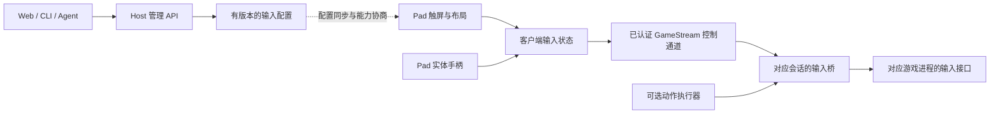

# 虚拟手柄完整优化方案

日期：2026-11-09。版本：设计 v0.1。文档任务：NXB-119；任务状态以 [backlog](../tasks/backlog.json) 为准。

本文整合 S2Arm 输入实现调研，以及 NXBridge Pad 的交互、UI、配置、输入可靠性和动作宏优化。除“当前基础”明确列出的事实外，以下内容均为拟实现需求，不表示已经部署或通过游戏验收。本轮只交付文档，没有修改客户端、服务端运行代码或操作设备。

## 1. 目标与优先顺序

让玩家在 Pad 上容易够到、看清和组合操作常用控件，能够调整布局并可靠恢复；同一家庭的不同玩家、游戏和设备各自保留习惯。让 agent 通过受约束的配置调整手柄，无需每改一个位置就重新构建 APK。

优先顺序：

1. 明确的布局编辑器、按游戏保存和恢复机制。
2. 按手型选择预设、减少画面遮挡、改善摇杆与触控反馈。
3. 统一输入快照、来源仲裁、断线释放与采样观测。
4. 通过独立输入工作台验证后，再实现和校准游戏动作宏。

输入正确性是持续约束，发现卡键或串会话问题时优先修复。UI 改进可在现有 Moonlight Android 客户端上独立推进；引擎更换不作为前置条件。此方案不宣称提高游戏渲染 FPS，重点指标为误触、操作成功率、调整成本、输入延迟和运行开销。

## 2. 当前基础与真实缺口

| 范围 | 已有依据 | 本轮设计需要补齐 |
| --- | --- | --- |
| 触屏布局 | 324 已引入左右浮动摇杆、独立操作区域、固定模式切换、按键优先及部分取消释放验证 | 明确的编辑工具栏、按游戏保存、手型预设、逐台真实握持验收 |
| 界面与启动 | 游戏库封面管理已有实现；331 的启动加载页在两台 Pad 验证了部分 BOTW 启动、退出及控件恢复流程 | 布局入口与加载、编辑、重连状态协调；不重做已有加载页 |
| 普通输入 | 认证 GameStream 手柄输入经本机会话路径进入游戏；接收器已有 `held/latch`、顺序检查及超时清理 | 控制权代次、来源仲裁、组合快照和明确的采样观测；当前按键合并及摇杆较大幅值选择不作为正式仲裁方案 |
| 短按 | 锁存可以让一次短按留到接收器被采样 | 同键连续点击的释放边沿、方向与按钮同时有效，不能由单个锁存位保证 |
| 动作宏 | 已有后翻、左右侧跳、招架、滑盾的需求 | 执行器、触发协商、配置校准和真实动作验收尚待实现 |
| 多人 | 有独立进程和双 Pad 画面的探索记录 | 完整输入隔离、所有断线情形及并发容量仍须分别验收 |

依据：[NXB-112](reports/NXB-112.md)、[NXB-117](reports/NXB-117.md)、[NXB-118](reports/NXB-118.md)、[GameStream 输入转发](../crates/nxbridge-gamestream/src/game_input.rs)、[现有接收器](../adapters/input/nxbridge_input.c)。引用历史记录不表示本轮重测，具体任务是否完成以 backlog 为准。

与既有设计的关系：本文件补齐客户端交互与完整优化路线；输入边界遵守 [输入桥接口](input-bridge.md)，动作语义遵守 [动作宏需求](input-bridge-requirements.md)，管理与权限遵守 [Web 管理和游戏库设计](web-management-and-game-library.md)。不重新定义第二套互相冲突的宏参数或任务状态。

## 3. S2Arm 的可借鉴部分与适配边界

本轮审阅修订为 `93bf8c6cab24934b3fe05af4bc04cba1fec84328`，提交日期 2026-11-08。以下依据源码和文档，不构成 NXBridge 上的实测结果；固定来源列在文末。

| S2Arm 做法 | NXBridge 的采用方式 |
| --- | --- |
| 透明描边按键、按下填充、闲置淡出、浮动摇杆 | 统一视觉状态，保留足够触摸面积，真机比较可读性和误触 |
| 游戏内编辑有完成、取消和恢复默认；游戏库也能进入布局编辑 | 统一使用同一配置；提供显式工具栏，保留可发现的入口 |
| 布局按游戏存储，可校验、导入和导出 JSON | 扩展为玩家、游戏、设备适配档和修订号；允许 agent 提交有限布局变更 |
| 摇杆死区、外圈饱和、响应曲线 | 在 NXBridge 中允许左右分别调整，移动和镜头使用不同预设 |
| 输入快照带来源、代次和时间戳；变化可唤醒 HID 提交 | 借鉴状态管理和测量方式，按实际 nxnative 接口适配 |
| 独立输入工作台、输入录制 | 复用生产控件和映射代码做测试；游戏动作仍在真实游戏中验收 |

需要保留的区别：

- S2Arm 的 UIKit / SwiftUI 代码需要转换为现有 Android 客户端实现，不能直接移植 UI 类；布局格式也不是天然兼容协议。
- 它的库内编辑页使用游戏封面预览，不能判断真实 HUD 遮挡；NXBridge 优先用当前游戏画面或本地最近一帧作为预览背景。
- 四指长按可以作快捷方式，不能成为唯一设置入口。保留易发现、可恢复的菜单按钮。
- S2Arm 的输入泵有首次 HID 提交后保留短按 20 ms 的实现，也明确承认快速连点可能合并、低频采样不保证读取。该数值不直接成为 BOTW 的采样时长或盾反时机。
- S2Arm 本地双手柄路径包含真人输入镜像，不能用作不同玩家独立串流的路由实现。
- 它的 UI 轻反馈和游戏震动是两条路径；本地按键反馈不能表示主机已经收到或游戏动作已经成功。
- 上游 F01 文档仍列出真实游戏、部分设备和手感验收缺口；借鉴代码不继承其未完成的验收。

## 4. 模块边界



- **客户端**负责绘制、触点归属、摇杆映射、编辑草稿、即时触感和普通输入发送。
- **Host**负责玩家和设备授权、控制权、配置版本、会话归属及生命周期。Web、CLI、agent 共用管理 API。
- **会话输入桥**负责有效代次、顺序、来源仲裁、中和和运行时适配；宏在这条路径附近执行。
- **游戏运行时**提供输入接入和可验证的采样边界；媒体 ABI 不承担宏逻辑。
- 实时按键继续沿 GameStream 发送。配置同步、宏命令与回执须单独设计能力协商，不能假设原版 Moonlight 已支持这些扩展，也不占用猜测出来的协议保留位。
- 在管理 API 和同步能力未实现前，先支持客户端本地布局文件。同步尚未成功时不显示“已同步”；不为布局控制新增一个未经认证的 LAN 输入服务。

## 5. 页面、入口与状态

### 5.1 游戏库与游戏内入口

游戏卡片提供“控制布局”入口，可预先配置；游戏内保留轻量菜单按钮，进入后显示继续、控制布局、手柄设置及退出串流。菜单位置避开常用按钮和系统返回手势区，可移动但不能编辑到不可恢复的位置。

普通玩家看到“仅此游戏”“此设备”“我的布局”等含义明确的文字。协议版本、输入代次、内部端点等放入诊断详情。保留已有封面、配对、游戏入口和启动加载功能。

### 5.2 状态与输入规则

| 状态 | 玩家看到什么 | 输入处理 |
| --- | --- | --- |
| 连接 / 启动等待 | 沿用加载提示与退出入口 | 虚拟手柄隐藏或禁用，不能积攒启动前按键 |
| 正常游玩 | 游戏画面、必要控件、菜单入口 | 按当前控制权发送普通输入 |
| 菜单打开 | 有明确返回入口的设置面板 | 先取消当前来源触点并释放；菜单触摸不进入游戏 |
| 布局编辑 | 被选控件、工具栏、安全区和可选热区显示 | 编辑触摸只调整草稿；禁止同时驱动游戏 |
| 试按 | 输入状态可视化与“仅试按，不操作游戏”提示 | 通过生产映射显示本地结果，不发送到游戏 |
| 断线 / 重连 | 连接状态、重试或退出入口 | 中和旧来源；重新获得控制权后必须用新的触摸开始 |
| 实体手柄接管 | 控件可淡出，菜单仍可发现 | 按来源策略切换；旧触屏状态不得复活 |

进入菜单、编辑或试按时，本客户端拥有的触屏与实体手柄均停止向游戏提交操作；有活动宏时取消对应宏。操作 UI 的手柄输入只用于界面导航，不能同时泄漏到游戏。恢复游玩时等待旧触点结束、旧按住状态释放后再接收新的操作，其他玩家不受影响。

进入菜单或编辑不代表游戏引擎已暂停。没有真实暂停能力时提示游戏仍在运行；正式试玩由玩家退出编辑后进行，不用屏蔽输入冒充暂停。

## 6. 布局编辑流程

标准流程：选择预设 → 点选控件 → 拖动位置或调参数 → 试按 → 保存。工具栏显式提供“位置 / 大小 / 透明度”“试按”“取消”“保存”和“恢复默认”，不再依靠重复点齿轮猜测模式。

编辑器要求：

1. 顶部显示当前游戏、布局名和“未保存”状态；选择控件后显示名字与当前参数。
2. 背景优先使用当前视频或本地已解码的最近一帧；只在进入预览时取需要的画面，不增加持续 GPU 读回。不把游戏截图写入可分享布局文件。没有画面时用标明用途的示意背景。
3. 拖动时限制在有效安全区内；位置吸附可关闭。支持撤销本次操作和恢复进入前的草稿。
4. 用选中描边和尺寸手柄说明可编辑对象；红色用于错误，不能让所有普通编辑控件都像故障。
5. 按键可按组移动，首版保留 Switch 面键相对顺序。调整组大小时检查所有成员、热区和安全区边界。
6. 摇杆激活区与可见摇杆半径分别编辑；编辑器显示两者含义，避免把大操作区误认为必须画出的巨大摇杆。
7. 保存成功后才显示“已保存”；失败时保留草稿和上次有效配置，提供重试。取消不写入配置。
8. 恢复默认只切换到默认预设，保留自定义方案；显示当前恢复作用于哪款游戏和设备，并允许回到之前的方案。
9. 转屏、安全区变化、切游戏或失联时，结束现有触点并停止试按；草稿可保留但须重新校验、预览，不静默应用错误尺寸。
10. 从编辑返回游玩时不复用仍压在屏幕上的手指；重新按下才产生游戏输入。

游戏库和游戏内入口读写同一个布局修订，防止形成两套“我的布局”。

## 7. 视觉、可达性与操作反馈

### 7.1 画面层次

- 游戏画面保持主体；控件集中在左右拇指活动区，中部保留视野。默认肩键以可达性优先，不机械贴在屏幕顶端。
- 面键保持 Switch 的 A/B/X/Y 空间关系和清楚标识。通用按钮名优先，游戏动作说明放在设置和可选提示里，避免不同游戏误导。
- 普通态使用克制的半透明底或描边；按下态有明显填充或亮度变化；编辑选中态用单独的强调色。不能仅靠颜色区分状态。
- 浮动摇杆随触摸出现，释放后消失。闲置按键可淡出，按住时不得因计时器变暗到难以辨认；菜单入口保留可发现性。
- 允许高对比度、较大文字和禁用淡出的设置；在亮、暗游戏画面上分别核可读性。

### 7.2 触摸区域与预设

可见框与实际命中热区分开定义。小尺寸视觉不意味着小触摸区；编辑时可以显示热区。以 Android dp、实际安全区和设备报告的尺寸处理，不直接把 iOS pt 或截图像素照搬为 dp。

候选预设为“小手紧凑”“标准”“大屏靠边”。这些是待握持验证的起点，不是自动适配结论。肩键距离、面键间距、左右区宽度和摇杆行程可调整；不得只按屏幕对角线推断手型。

首轮将主要按钮热区不小于 48 dp 作为候选起点；若当前屏幕放不下，应提示调整布局，不静默缩成难以命中的目标。该值需在实际设备上验证，不能凭像素换算宣称舒适。

必需按键保持可访问，L3/R3 提供显式按钮选项。游戏 HUD 避让先依靠预览和手工调整，不宣称已有自动识别血量、小地图或字幕的能力。

### 7.3 反馈语义

本地按下立即高亮，可在设备支持时轻震；不等待串流画面返回。持续按住不反复震动，摇杆每次触点首次到外圈可选反馈一次。UI 轻反馈、游戏震动和宏状态提示分别管理，关闭其中一项不隐式关闭其他项。

本地反馈只说明触控被客户端接受。只有协议支持且主机确有回执，才能显示“已接收”或“执行结束”；实际招架、跳跃成功仍需游戏证据。失去控制权或连接失效时不显示可执行成功的状态。

## 8. 摇杆与多指交互

### 8.1 浮动与固定模式

- 浮动模式在合法激活区内以首次落点为中心，本次触摸期间中心不漂移；固定模式使用保存圆心。两种模式分别保存几何，切换不覆盖另一套设置。
- 命中优先级为菜单 / 编辑控件、可见按键、摇杆激活区。左右摇杆激活区不重叠；系统保留区域不得拦截。
- 触点开始后记录归属直到结束；滑出一个按钮不能被另一个摇杆抢走。十字键可采用明确的方向滑移规则。
- 一根摇杆同一时刻只有一个控制触点，其他触点可以操作按钮和另一根摇杆；多指按住同一键时，最后一个所有者释放才归零。
- `ACTION_CANCEL`、切后台、控件移除、编辑、来源切换都清理归属、短按锁存及双击候选，不能只有正常 `ACTION_UP` 才回中。
- L3/R3 的点按、双击按住作为可选手势，并提供试按说明和关闭方式；不能让普通推杆结束意外触发蹲下或瞄准。

### 8.2 响应曲线

左右摇杆分别提供中心死区 `d`、达到满量程的半径比例 `s` 和响应指数 `e`。设原始归一化位移长度为 `r`：

```text
r <= d: 输出为零
r > d:  输出长度 = clamp((r - d) / (s - d), 0, 1)^e
```

保持方向，限制在单位圆内，明确 Y 轴转换只发生一次。校验所有数值有限，且 `0 <= d < s <= 1`、`e > 0`。候选调节范围参考 S2Arm：`d` 为 0–0.4、`s` 为 0.5–1、`e` 为 0.5–3；默认 0.08 / 1 / 1 仅作为对照起点。

左杆可偏向容易走到全速，右杆可偏向中心细调；玩家通过实时轨迹和输出值试按。触屏映射只处理一次，避免叠加客户端已有死区导致大块无响应区。实体手柄使用独立配置，不能被触屏曲线误处理。

## 9. 布局数据、迁移与 agent 操作

### 9.1 数据归属

建议有效配置按 `(profile_id, game_id, device_class, orientation)` 解析。选择顺序为：当前玩家的游戏设备覆盖 → 玩家游戏布局 → 玩家设备预设 → 内置预设；解析后保存明确的来源和修订，不能在游玩时因默认值变化而突然换布局。

`game_id` 采用游戏库稳定身份，封面和标题变化不改变布局归属。设备适配档包含客户端报告的有效尺寸、密度和安全区，不靠设备型号猜测。共享预设只共享几何和允许的手感参数，不共享控制权或存档。

| 配置内容 | 设计要求 |
| --- | --- |
| 版本与身份 | schema 版本、布局 ID、修订号、预设来源；更新检查基准修订 |
| 按键 | 受支持的语义 ID、中心、大小、形状、热区；按键 ID 与协议映射分离 |
| 摇杆 | 固定 / 浮动、激活区、圆心或半径、左右独立响应参数、可选 L3/R3 手势 |
| 外观与反馈 | 活跃 / 闲置透明度、对比度、文字、UI 轻反馈；与游戏震动设置分开 |
| 可选动作 | 已协商且适用游戏构建的动作 ID；不保存可执行脚本 |
| 适配信息 | 参考安全区、方向和设备适配档；导入时检查实际投影结果 |

本节是 NXBridge 配置设计，不是已经实现的 schema，也不保证直接导入 S2Arm JSON。

### 9.2 几何与校验

按键中心以安全区宽、高分别归一化，按键尺寸以短边为比例；摇杆激活矩形以安全区宽、高归一化。客户端负责投影，并检查投影及边界钳制后的热区，而非只检查原始比例。

候选限制为文件最多 64 KiB、32 个可见控件和两个摇杆。闭合 schema 拒绝未知版本、未知动作、非有限值、重复 ID、越界和冲突激活区。正常布局须完整覆盖基础 Switch 控制；仅触屏或实体手柄模式另有能力声明，不通过删掉必需按键伪装普通布局。

热区冲突须有可解释的优先级和提示；预览中高亮实际冲突区域。配置不包含 shell、脚本、任意文件路径、资源下载地址、游戏文件、密钥、存档或配对凭据。

导入先解析、校验和预览，再保存为独立修订。写入失败保留上次有效配置；坏文件保留并说明问题。未知版本不静默按旧格式解释。撤销切回前一修订，不删除用户方案。

### 9.3 旧布局迁移

现有客户端布局与配对数据保留。第一次引入新配置时，把旧布局导入为可恢复的本机方案并记录原版本；缺少游戏身份时标为“旧通用布局”，由玩家选择是否复制到当前游戏。升级不能无提示覆盖用户调整。

布局、手感和外观分别有恢复范围；“恢复按钮位置”不同时清除摇杆曲线和震动偏好。导出时明确包含哪些项目。

### 9.4 Agent 工作流

1. 读取当前有效布局、修订、设备几何和能力；未知几何时先读取客户端报告，不猜坐标。
2. 将“右侧按键靠内一点，ZL 放大 15%”转换为有限配置差异，说明影响哪些控件。
3. 校验必需按键、安全区、热区冲突和旧修订，生成预览。
4. 按用户指令保存草稿或应用；已明确要求应用的修改不增加额外确认流程。产品界面提供预览、应用和撤销能力。
5. 返回客户端实际应用的修订和结果；离线时说明尚未应用，不能把服务器保存成功当成 Pad 已生效。

Web、CLI、agent 通过同一管理 API 操作；在线编辑与 agent 更新采用修订冲突检测，不能最后写入者无条件覆盖。运行中应用布局时先取消触点并中和对应来源，新触摸才使用新几何。

## 10. 输入快照、来源与时序

### 10.1 一致快照

内部输入状态应绑定会话、游戏运行代次、控制权代次、来源、递增序号、配置修订，以及按键与四轴。按钮和轴在同一提交边界发布，避免“跳跃还在、后方向已经归零”的半个组合。

主机记录入口、状态发布、运行时取样等本机单调时间戳。Pad 时间只用于本端阶段；未经校时不能跨设备相减。运行时读函数返回、写入 HID 和游戏逻辑真正消费是不同边界，报告必须说明实际观测到哪一层。

普通摇杆采用最新有效状态，不堆积过期移动轨迹。按钮边沿采用有界、保序的方式；连续两次短按要保留中间释放。溢出不能静默丢掉释放后继续保持旧按键，应中和相应来源并记录原因。

### 10.2 控制来源仲裁

- 客户端触屏和连接在该 Pad 上的实体手柄先形成明确的主输入来源；采用有意义的操作作为切换意图，摇杆噪声或重复状态包不能反复抢权。
- 切来源时清理旧来源的触点、短按和手势，更新输入代次。非当前来源的历史状态不能在下一次切回时复活。
- 每个来源的按键贡献独立保存。宏只占用声明的按键 / 轴，取消后回到最新人工状态；不按摇杆幅值大小抢控制，也不把全部来源 OR 后统一清零。
- 连接在 Mac 上的本地物理手柄必须由 Host 显式分配，不能默认同时作用于所有游戏进程。
- 同一 BOTW 进程首版只有一个控制者；旁观不获得输入权限。真正支持同屏合作的游戏另行定义多手柄槽位和验收。

### 10.3 提交、短按与断线

输入变化尽快送入对应运行时；必要心跳和反馈使用独立的单调调度，不能因为持续移动不断推迟。UI、输入与渲染线程不等待网络、文件写入或宏延时。

短按在游戏采样处验证，不能直接复制 S2Arm 的 20 ms 保留值，也不能把 30 FPS 的 33.3 ms 当成通用动作时长。普通输入不因宏功能新增固定一帧等待；宏步骤需要的采样确认由执行器单独管理。

客户端退出、后台、取消触摸、控制权撤销、运行代次变化或连接失效时中和对应来源，清理锁存和在途宏。失联中和沿用已有需求的初始目标 250 ms，仍待故障测量；仅本地中转心跳或宏执行不能证明远端玩家仍在线。重连不恢复旧按住状态。

## 11. 游戏动作、触屏直通、体感与震动

### 11.1 BOTW 动作键

动作执行与 [输入桥迭代需求](input-bridge-requirements.md) 保持一致：后翻、左右侧跳、招架、滑盾。动作区由玩家显式开启，显示可理解的动作名和图标，避免混入通用面键。未校准的游戏版本或不支持的客户端不显示可执行状态。

首版一会话最多一个宏、无待执行队列、每宏最多 32 步且总时限最多 2 秒；这些是工程上限，不是实际动作时长。首次触发走网络，后续步骤在主机执行；人工冲突输入可取消，未冲突镜头输入继续直通。

UI 区分“已发送”“主机执行中”“输入序列结束”和“已取消”；没有主机回执只能显示已发送或状态未知。招架宏不代表完美盾反，后翻宏不代表完美闪避。录制回放可辅助重现路线，但受游戏状态和时序影响，不承诺确定性游戏结果。

### 11.2 可选输入能力

- **触屏直通**：针对支持原生触摸的游戏另行协商，与虚拟按键模式互斥。坐标由客户端实际视频矩形、黑边、裁切和游戏逻辑画布共同映射；不能用 Pad 屏幕像素或编码尺寸直接冒充游戏坐标。分辨率倍率和几何变化后重新校验。
- **体感**：明确坐标系、单位、采样时间和屏幕方向；按当前会话和来源路由。未完成传输及运行时适配时标为不支持或实验中。
- **游戏震动**：主机反向消息绑定控制代次和目标设备，有限幅度、时长及过期处理；断线和来源变化停止旧反馈。UI 轻反馈仍在客户端即时执行。

以上能力按客户端、游戏构建和后端分别登记，不能从 S2Arm 有实现推导 NXBridge 已支持。

## 12. 多玩家、性能与观测

独立玩家对应独立会话和游戏进程，各自接收该进程的首个手柄槽位。禁止把两个 Pad 的输入镜像进两份游戏，也不能把 BOTW 的两个手柄槽当成两份独立进度。配置同步只更新获得授权的玩家和设备。

观测分三层：客户端触控到发送、主机接收到有效输入提交、输入到玩家屏幕变化。按键反馈不代替端到端测量；测试分别记录游戏 FPS 与串流 FPS。

性能约束：

- 不增加持续游戏截图或 CPU 像素读回；预览使用已有帧，诊断采集显式开启。
- 控件按输入与视觉变化更新，布局解析和持久化离开实时输入路径；避免为闲置控件维持无意义的绘制或震动。
- 队列、录制和日志有容量限制；热路径尽量复用对象。输入追踪记录 schema、修订、阶段、序号和丢弃原因，游戏截图与敏感数据不自动上传。
- 性能测量运行与重探针诊断运行分开。显示或日志优化前后保持相同游戏、配置、设备和网络条件，按 [性能与验收](validation.md) 报告 p50/p95/p99 与原始样本。
- UI 优化不直接增加已验证并发容量；多会话必须逐路验证输入隔离与响应，再讨论容量。

## 13. 验收矩阵

下列是实施验收要求，均不能据本文标记为通过。无游戏测试使用生产控件、映射和配置解析器，不能用另一套理想模型替代被测实现；UI 测试通过后仍需真实手指和游戏验收。

| 编号 | 场景 | 验收依据 |
| --- | --- | --- |
| VC-01 | 主要 Pad 的横屏、安全区、亮暗背景及候选手型预设 | 必需控件可达、可读、没有被裁切；误触、跨度和 HUD 遮挡记录具体问题 |
| VC-02 | 编辑、试按、取消、保存、恢复与转屏 | 模式明确；试按不进游戏；取消不写入；保存失败可恢复；返回后旧手指不产生输入 |
| VC-03 | 旧布局升级与配对保留 | 原数据保留，迁移可恢复；切游戏不会覆盖另一游戏或玩家布局 |
| VC-04 | agent 与本地编辑并发、旧修订提交、客户端离线 | 拒绝冲突覆盖，清楚报告保存和实际应用状态，能撤销到之前修订 |
| VC-05 | 非法、过大、未知版本及热区冲突配置 | 拒绝或明确提示；保留上次有效方案；正常路径无越界控件 |
| VC-06 | 左右杆同时操作、杆加面键、ZL 加方向加 X、多指同键 | 生产输入跟踪与预期一致，组合不拆散，释放后回零 |
| VC-07 | 同键两次短按、按住、连点、L3/R3 手势 | 保留需要的释放采样，普通推杆无意外点击；界限和失败计数可复查 |
| VC-08 | 取消、切后台、编辑、转屏、实体手柄接管 | 清除对应触点、锁存和手势；其他会话不受影响 |
| VC-09 | 网络静默、半包、重连、旧代次、服务或游戏退出 | 中和时间实测；旧按键和宏不复活；本地心跳不能掩盖远端失联 |
| VC-10 | 两玩家不同游戏 / 布局并发操作 | A 的按键、配置、取消和重连不改变 B；逐路保留证据 |
| VC-11 | UI 轻反馈、游戏震动、无马达设备 | 独立开关，实际反馈符合能力，取消和切源不残留震动 |
| VC-12 | 独立输入工作台 | 显示按键、四轴、触点归属、来源和状态变化；不把工作台显示回调计成游戏帧 |
| VC-13 | 普通输入时延与 UI 开销 A/B | 相同条件下记录客户端、主机及端到端分段；没有无依据增加的固定等待 |
| VC-14 | BOTW 五动作 | 复用动作宏需求 AC-01 至 AC-08；输入日志与实际动作、完美操作结果分开 |
| VC-15 | 触屏直通、体感等可选能力 | 只有单独完成坐标、方向、时序及真机验证的组合才标记支持 |

真实握持验证应覆盖：连续移动与转镜头、移动加冲刺、锁定加跳跃、菜单选择、意外触摸与恢复。记录设备、布局修订、玩家反馈、误触次数和调整过程；不由 ADB 模拟触摸代替手感结论。

## 14. 实施拆分与完成定义

以下为实施批次建议，不新增或代替 backlog 中的任务状态。

| 批次 | 交付内容 | 完成条件与既有任务关系 |
| --- | --- | --- |
| A：编辑与配置 | 显式编辑工具栏、草稿 / 取消 / 保存、按游戏保存、旧布局迁移 | VC-01 至 VC-05；承接 NXB-112 的设备和布局证据，保留 NXB-118 加载状态行为 |
| B：视觉与手感 | 预设、热区、闲置淡出、左右响应曲线、本地轻反馈 | VC-01、VC-06 至 VC-08、VC-11；有真实握持记录 |
| C：可靠输入与工作台 | 统一快照、来源和代次、采样观测、故障注入、输入工作台 | 与 NXB-050 协调；VC-06 至 VC-13，不以模拟测试替代多会话实测 |
| D：Agent 配置 | 统一管理 API、差异预览、修订冲突、应用结果和撤销 | 依赖 A 及管理 API 的实际能力；VC-04、VC-05、VC-10 |
| E：动作与扩展 | BOTW 五动作、可选体感 / 触屏 / 震动适配 | NXB-051 / NXB-052 / NXB-053 按原依赖推进；VC-14、VC-15 |

每批按实际完成的功能开放 UI。不能只增加一个不可执行的按钮，也不能把已写入需求的能力显示为已支持。新实现任务需单独明确文件范围、设备所有权和依赖，按 agent 规则顺序推进。

## 15. 固定来源

S2Arm 引用均固定到本轮审阅提交，避免后续 `main` 变化使结论失去依据：

- [触屏布局规格与验证边界](https://github.com/jhaizhou-ops/S2Arm/blob/93bf8c6cab24934b3fe05af4bc04cba1fec84328/docs/触屏布局_F01.md)：坐标、热区、多指、淡出、手感与实际验证范围。
- [游戏内虚拟手柄](https://github.com/jhaizhou-ops/S2Arm/blob/93bf8c6cab24934b3fe05af4bc04cba1fec84328/ios/vpad.m)：绘制、触点归属、编辑和取消处理。
- [游戏库布局编辑器](https://github.com/jhaizhou-ops/S2Arm/blob/93bf8c6cab24934b3fe05af4bc04cba1fec84328/shell/Sources/S2ArmShellHost/S2ArmTouchEditorView.swift)：封面背景、拖动和外观预览；与游戏内编辑器的操作项存在差异，采用时以代码为准。
- [按游戏保存布局的宿主桥](https://github.com/jhaizhou-ops/S2Arm/blob/93bf8c6cab24934b3fe05af4bc04cba1fec84328/ios/vpad_shell.m)、[AI 布局说明](https://github.com/jhaizhou-ops/S2Arm/blob/93bf8c6cab24934b3fe05af4bc04cba1fec84328/ios/layouts/AI使用说明.md)：数据归属、可校验导入和几何信息。
- [输入快照接口](https://github.com/jhaizhou-ops/S2Arm/blob/93bf8c6cab24934b3fe05af4bc04cba1fec84328/runtime/include/s2a_pad.h)、[状态实现](https://github.com/jhaizhou-ops/S2Arm/blob/93bf8c6cab24934b3fe05af4bc04cba1fec84328/runtime/src/pad.c)：来源、代次、锁存、通知和阶段耗时。
- [HID 输入泵](https://github.com/jhaizhou-ops/S2Arm/blob/93bf8c6cab24934b3fe05af4bc04cba1fec84328/services/S2A.Services/InputPump.cs)：事件提交、短按可见窗口及双手柄镜像边界。
- [独立输入工作台](https://github.com/jhaizhou-ops/S2Arm/blob/93bf8c6cab24934b3fe05af4bc04cba1fec84328/ios/lab/README.md)：生产输入组件复用及无游戏验收的限制。

本文件总结设计，不复制上游代码。实际引入代码时按对应文件的许可证和本仓库 [来源记录](open-source-provenance.md) 保留声明。

## 16. 本次文档交付与交接

本次范围为本文、README 文档入口、状态说明和 NXB-119 的文档任务记录。没有接管其他实现任务，没有修改运行配置、设备设置、游戏进程或玩家存档。

交付检查：`make check` 通过，检查了 57 份 Markdown、49 项任务、JSON 元数据和 Python 语法；`git diff --check` 通过。本轮没有运行设备、游戏或性能测试，未新增文档变更不需要的单元测试。文档检查不能作为上述 VC 验收通过的证据。

下一步从批次 A 的可执行任务拆分开始，按实际实现更新对应能力与证据。NXB-119 的完成仅指本文与文档入口交付；其他输入、布局和动作宏任务的状态保持不变。
