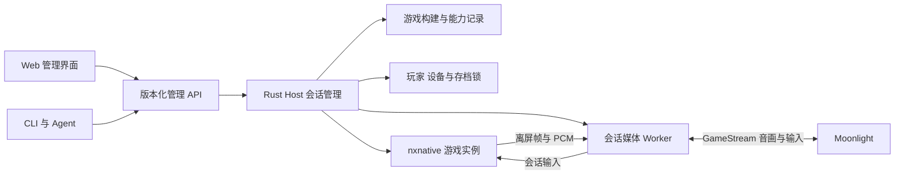

# Web 管理与多游戏支持设计

日期：2026-11-02。版本：v0.1。范围：产品化设计；已有本机状态与游戏库登记原型，完整管理 API 和多游戏接入尚待实现，任务状态见 [backlog](../tasks/backlog.json)。

NXBridge 面向家庭玩家提供游戏库、独立进度和可恢复的串流会话。BOTW 是第一个验证完整链路的游戏；其他游戏在完成 nxnative 运行、离屏音画、输入和存档验收后加入游戏库。Web 管理界面负责配置与管理，日常游玩继续使用 Moonlight。

## 产品入口

| 使用者 | 入口与职责 |
| --- | --- |
| 家庭管理员 | 在 Mac 或局域网浏览器中配置主机、登记游戏构建、管理玩家和设备、查看会话与诊断 |
| 玩家 | 使用自己的档案选择游戏、继续会话或排队；通过 Moonlight 接收音画并操控游戏 |
| Agent 与 CLI | 调用与 Web 相同的管理 API，读取结构化状态、执行授权范围内的操作并获取明确结果 |

首版提供管理员 Web 界面。玩家网页在家庭入口阶段增加，只呈现选游戏、继续、排队和退出等必要操作。网页唤起 Moonlight、传递目标会话和恢复已有连接需做客户端兼容验证；在这之前提供明确的手动连接步骤。游戏画面与实时输入沿用 GameStream 链路。

首个部署环境仍是已登录的 macOS 用户会话。浏览器可以远程访问管理服务，但主机的无显示器、锁屏和未登录能力继续按 [主机状态验收](game-session-server.md) 分别记录。

## Web 页面

| 页面 | 产品化内容 | 操作边界 |
| --- | --- | --- |
| 总览 | 当前玩家、游戏、会话状态、游戏 FPS、串流 FPS、内存压力与排队情况 | 指标带采样时间；缺失值显示未知，过期值显示过期 |
| 玩家与设备 | 玩家档案、配对请求、已配对设备、设备可使用的档案 | 管理员批准或撤销授权；控制者变更通过 Host 执行 |
| 游戏库 | 已准备好的游戏构建、可用性、已验证功能、画质预设 | 登记、检查、停用构建；保留版本与验收依据 |
| 会话 | 启动、连接、请求正常退出、排队与取消；生命周期完成后增加恢复 | 状态来自 Host；退出结果区分已确认保存、未确认保存和异常终止 |
| 诊断 | 启动失败原因、按会话统计、有限日志、脱敏诊断包 | 显示错误对应的处理建议；默认导出不含游戏、存档、密钥和凭据 |

普通玩家只看到获授权的档案与会话。高级构建参数、运行代次和内部端点保留在管理员详情或诊断中，游戏选择页以游戏名称、可用功能和可理解的失败原因呈现。

浏览器关闭、刷新或管理登录过期均不结束游戏。正常退出请求由 Host 持续处理；前端重新连接后查询最终结果。保存成功须由运行时可验证的提交结果支持，进程退出本身不能作为保存成功的依据。

## 管理服务架构

由 `nxbridge-host` 提供管理 API 和构建后的静态网页资源。前端随程序分发，由 Rust Host 在运行时提供；前端框架和构建工具在实现时选定。主机上的会话管理、媒体 worker 与游戏进程保留既有职责和故障边界。

Web、CLI、agent 和 GameStream 的启动请求最终调用相同的 Host 会话逻辑。存档锁、资源接纳、身份检查、启动回滚和退出规则在服务端执行，前端只提交意图与显示结果。管理 API 是管理入口；媒体和实时按键仍通过现有会话通道传输。

总览默认每秒更新一次聚合指标，日志采用有限分页，事件队列设置上限。慢浏览器断开后重新取得状态快照，不能让管理订阅阻塞游戏或媒体线程。首版总览使用游戏封面与状态，不默认运行每路实时画面预览。管理附加开销以开启与关闭页面的同场景测量验收。

## 管理 API 契约

以下为待实现的 v1 接口范围；具体请求结构在实现任务中固定为机器可读规范，并供 Web、CLI 和 agent 共用。

| 接口范围 | 职责 |
| --- | --- |
| `GET /api/v1/host` | 返回构建版本、已验证能力、主机状态和当前资源摘要 |
| `/api/v1/profiles`、`/api/v1/devices` | 管理玩家、配对请求和设备授权；读取与修改分别校验权限 |
| `/api/v1/games` | 登记和查询游戏、构建、预设及能力证据 |
| `GET /api/v1/sessions` | 返回调用者可见会话、当前状态与运行代次 |
| `POST /api/v1/sessions` | 以玩家、游戏构建、预设和获授权设备申请启动 |
| `POST /api/v1/sessions/{id}/resume`、`POST /api/v1/sessions/{id}/stop` | 恢复或请求正常退出指定会话；按对应生命周期能力开放 |
| `GET /api/v1/operations/{id}` | 查询异步操作的排队、执行、成功或失败结果 |
| `/api/v1/diagnostics` | 按授权范围读取指标、日志和生成诊断包 |

约束如下：

- 启动、退出等长操作返回 `operation_id`，接受请求与操作成功分开表达。失败结果包含稳定错误码和面向用户的说明。
- 写操作携带幂等键。同一调用者的同一请求重试返回原操作；相同键携带不同参数时返回冲突。已接受的操作与会话归属可持久恢复，服务重启先核实进程和存档锁再决定后续动作。
- 配置更新检查修订号；会话操作检查预期运行代次。浏览器旧页面或 agent 的延迟请求不能修改已被替换的会话。
- 管理员、玩家和 agent 的权限由 Host 校验。管理登录与 GameStream 设备配对分别验证；玩家只能操作获授权的档案，agent 使用限定权限的身份。
- 撤销设备授权时立即中和对应输入并使旧控制授权失效，随后按会话断线规则保留或退出游戏，其他玩家继续运行。
- 首次管理员建立在本机完成。局域网管理使用 HTTPS、身份验证和写请求来源校验；凭据不放入 URL、日志或诊断包。
- 游戏启动引用已登记的构建与受约束参数。游戏条目不向普通玩家开放任意 shell 命令执行。

接口与页面按已完成能力逐步开放。NXB-038 只提供经过验证的单会话操作，多玩家排队、恢复和生命周期操作随 NXB-060、NXB-080 接入。

## 多游戏模型

通用管理层处理玩家、设备、会话、媒体、输入路由和存档锁。游戏差异放入有版本的配置与适配层，核心服务不依赖 BOTW 名称、固定 title ID 或专属动作。

| 对象 | 需要记录的内容 |
| --- | --- |
| 游戏 `title_id` | 稳定游戏身份、显示名称、封面和该游戏可选择的构建 |
| 构建 `build_id` | 游戏版本、nxnative 与适配补丁修订、工具链和资源清单；明确对应的本机已准备资源 |
| 运行配置 | 启动入口、允许的参数、存档与临时目录适配、所需音画和输入能力 |
| 画质预设 | 游戏渲染尺寸与目标速度、独立的串流分辨率与帧率、编码设置及验证条件 |
| 输入配置 | 标准按键映射、体感与震动能力、可选动作宏以及适用构建范围 |
| 验收记录 | 游戏构建、主机环境、预设、测试场景、功能结果、性能样本和证据位置 |

游戏构建登记为不可变版本；运行中的会话固定自己的构建和配置修订。切换默认构建只影响后续启动，停用构建也不能删除正在使用的资源。实际游戏文件、密钥和私人路径保留在本机数据目录，仓库中的配置示例只记录结构。

能够通过数据表达的差异使用游戏配置；必须修改引擎的差异保留可定位的版本补丁。新增游戏先检查通用离屏媒体和输入契约，再补足游戏特有能力。BOTW 的盾反、后翻等宏属于该游戏的输入配置，按游戏、构建与配置版本匹配；其他游戏使用各自的动作集合。

### 存档与资源

持久存档按 `(profile_id, title_id)` 归属并取得独占写者锁，沿用 [会话隔离设计](sessions.md)。同一玩家启动该游戏的两个不同构建，也不能同时写同一个存档。临时目录和运行代次独立，可写缓存按兼容范围隔离；不可变游戏构建与资源可以共用。

升级或回退构建前检查存档格式兼容性。兼容性未知时保留原构建，管理员在没有活动写者的条件下使用独立副本验证；确认迁移前保留已提交存档的备份。改变构建版本不会自动创建新玩家进度，也不会把其他玩家的存档接入该会话。

### 可用性与性能

游戏条目分别记录离屏视频、音频、普通输入、体感、震动、保存加载和重连等能力，使用已验证、实验中、不支持、未知状态。原始记录通过 API 暴露明确状态与证据；用户界面据此显示可玩的模式和限制。

登记构建仅让它出现在管理游戏库中。玩家可启动的版本由管理员启用，启动前仍须检查本机资源和所需能力。实验构建明确标识；“已验证可玩”要求该构建完成真实游戏链路与保存加载验收。构建或关键配置变化后，受影响的验证项重新检查。

性能结果按游戏、构建、主机、预设和场景记录。游戏 FPS、串流 FPS 与输入到画面延迟分开呈现；未测指标使用未知值。不同游戏保持各自正确的游戏速度，帧率预设只有通过时序回归后才开放。

目标支持同一游戏的多个独立实例，以及不同游戏同时运行。混合游戏并发需要单独测量，每路分别达标才能登记该组合的容量。BOTW 的单路或双路结果不自动授权其他游戏组合；资源接纳使用已有证据与当前状态，容量不足时排队。游戏逻辑、渲染与工作集仍按实例消耗资源。

## 交付顺序

任务与依赖以 [backlog](../tasks/backlog.json) 为准。本设计不改变 NXB-035、NXB-037 和现有双实例验证的前置条件。

| 阶段 | 交付范围 |
| --- | --- |
| NXB-007 | 固定 Web 管理、多游戏模型、API 原则与验收边界 |
| NXB-036 | 本机只读状态 API 与概览原型，不开放写操作或局域网访问 |
| NXB-039 | 本机只读游戏与构建元数据，逐项显示登记能力及未知状态 |
| NXB-041 | 本机游戏、构建登记和已有目录绑定；不触碰游戏资源或存档 |
| NXB-038，依赖 NXB-037 | 最小管理 API 与 Web：管理员配置、配对、登记 BOTW 构建、单会话启动与正常退出、状态与诊断；单会话重试去重和存档锁必须成立 |
| NXB-040、NXB-050、NXB-060 | 继续验证双实例隔离并实现输入与生命周期；把对应能力接入统一 Host 管理逻辑 |
| NXB-080，依赖 NXB-038、NXB-060、NXB-070 | 完成家庭管理员与玩家流程、排队与恢复，验证 Moonlight 连接引导和长期使用体验 |
| NXB-081，依赖 NXB-038、NXB-060、NXB-070 | 选取另一款具有本地可用构建的游戏，验证配置扩展、真实功能和混合游戏并发；独立记录结果 |

NXB-081 不作为 BOTW 家庭入口或首版发布的前置条件。第二款游戏由可用的运行时构建和测试资源决定，本设计不指定尚未核实兼容性的游戏。前端技术选型、Moonlight 自动唤起方案和对外发布格式在对应实现任务中确定。

## 验收要求

| 编号 | 行为与判定 |
| --- | --- |
| WEB-01 | Web、CLI 与 agent 通过相同 API 获得一致结果；越权访问其他玩家会话失败，设备撤销按会话规则生效 |
| WEB-02 | 重复启动、页面刷新、操作重试及服务恢复不会产生重复存档写者；旧修订和旧运行代次返回明确冲突 |
| WEB-03 | 页面关闭后会话继续；退出、断线和恢复结果可重新查询；无法确认保存时界面保持真实状态 |
| WEB-04 | 慢浏览器和诊断订阅不造成无限队列；同场景比较页面关闭、打开和持续查询时的 CPU、内存、游戏帧时间及媒体延迟，已接纳会话仍满足 validation 的对应门槛 |
| GAME-01 | 用两个不同游戏配置验证登记、构建选择、存档定位和输入配置隔离；夹具结果单独标识，不能登记为真实游戏兼容性 |
| GAME-02 | 第二款真实游戏完成离屏音画、普通输入、保存加载、退出与重连；体感、震动和动作宏逐项标明结果 |
| GAME-03 | BOTW 与第二款游戏同时运行时分别验证音画、输入、存档和性能；按测试组合记录可接纳容量，失败保留证据 |

测试方法沿用 [性能与验收](validation.md)；多玩家归属和生命周期沿用 [会话设计](sessions.md)，动作宏沿用 [输入桥迭代需求](input-bridge-requirements.md)。本轮文档交付只检查设计、链接与任务依赖，功能验收由对应实现任务提供证据。
